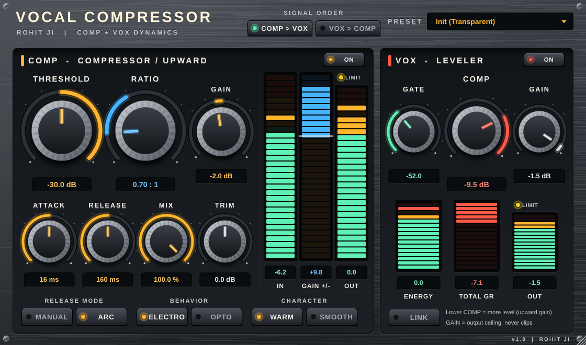

# Vocal Compressor by ROHIT JI

Two classic-style vocal dynamics processors in **one** VST3 plugin for Windows (FL Studio, Cubase, any VST3 host).
Same dark brushed-metal look as the other ROHIT JI plugins. **Blue = upward gain**, **gold = compression**, **red = VOX total gain reduction**.

## COMP (compressor / upward expander with models)

| Control | What it does |
|---|---|
| **Thresh** | -60 to 0 dBFS, with IN meter. Soft knee: it starts acting about 6 dB below the threshold. |
| **Ratio** | Big knob (turns blue below 1). **1.01 to 50** = compression (gold on the GAIN +/- meter). **0.99 to 0.50** = **upward expansion / gain** (blue on the GAIN +/- meter). |
| **Gain** | -30 to +30 dB output gain into a 0 dBFS limiter (light: yellow = limiting, red = 6 dB or more). |
| **Attack / Release** | 0.5-500 ms / 5-5000 ms. |
| **ARC / Manual** | ARC = automatic, program-dependent release (Release becomes the scaling factor). |
| **Electro / Opto** | Electro: release speeds up near 0 dB and slows down above 3 dB GR (loud). Opto: the opposite, "puts on the brakes" near 0 dB (smooth, vintage). |
| **Warm / Smooth** | Warm adds low-frequency harmonics as compression gets deeper. Smooth stays clean. |
| **Mix / Trim** | Parallel compression and post-limiter output level. |

## VOX (one-fader vocal leveler)

| Control | What it does |
|---|---|
| **Gate** | Gentle downward expander (watch the ENERGY meter). Raise it above the noise to clean the pauses. |
| **Comp** | Threshold + ratio in one fader. Lower it = more compression **and more level** (automatic make-up, upward gain). |
| **Gain** | Output ceiling. The limiter never lets the output pass it. |
| **LINK** | Moves Gain with Comp so the level stays even while you set the amount. |
| **Signal order** | COMP > VOX or VOX > COMP. Each section has its own ON button. |

12 presets: Init (Transparent), Vocal Gentle Opto, Vocal Upfront, Rap Vocal Loud, Podcast Leveler, Upward Lift (Gain),
Electro Loud, Opto Smooth Warm, Gate + Vox Comp, Background Vocals, Parallel Punch, Vox Only Leveler.

## Download

Go to **[Releases](../../releases/latest)** and pick:

| File | For |
|---|---|
| **Vocal-Compressor-Setup-64bit.exe** | 64-bit FL Studio, Cubase and other modern DAWs (most people) |
| **Vocal-Compressor-Setup-32bit.exe** | Older 32-bit DAWs only |

Run it and click **Next > Install > Finish**. The plugin goes to `C:\Program Files\Common Files\VST3`.

## How it is built

Every push builds the plugin with MSVC (x64 and Win32) on GitHub Actions, packages each into its own setup
wizard (`Installer/setup.iss`, Inno Setup) and publishes them as the latest release.
Original design and code; not affiliated with any other plugin maker.
